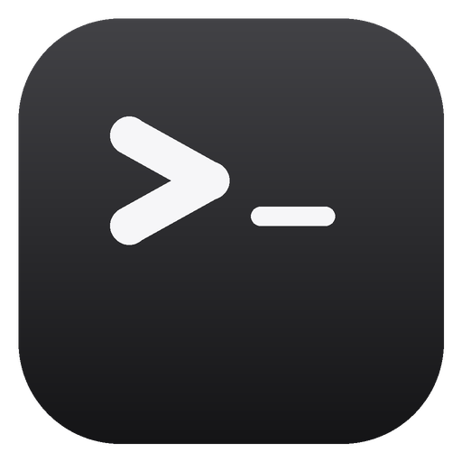
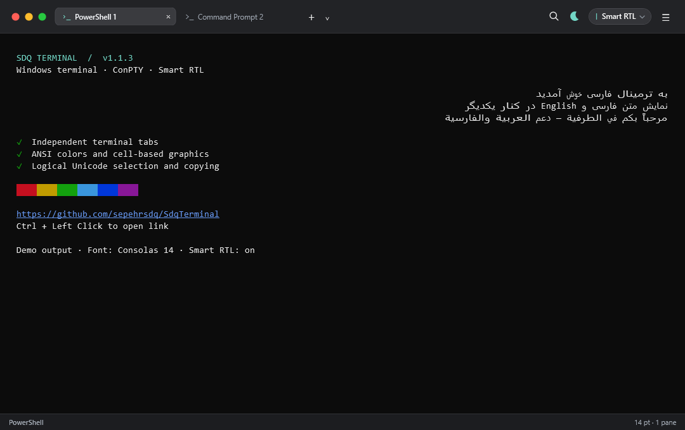
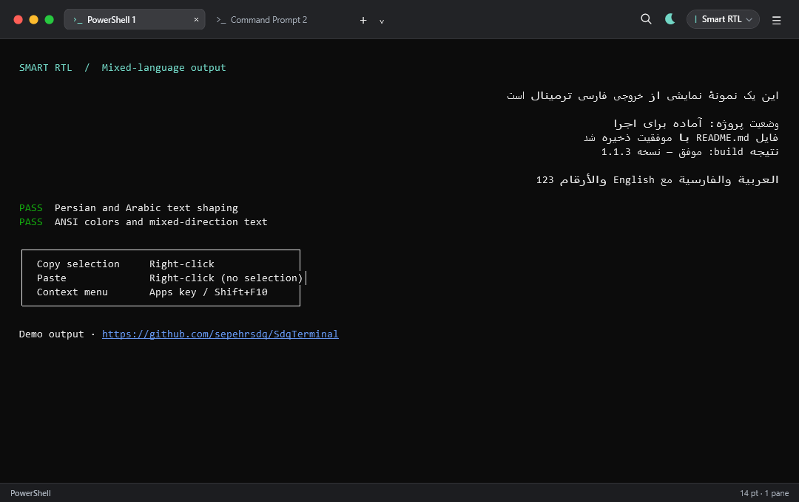

<div align="center">
  

  # SdqTerminal

  **A Windows terminal emulator with Persian, Arabic and right-to-left text support**

  **ترمینال ویندوز با پشتیبانی از فارسی، عربی و نمایش راست‌به‌چپ**

  **محاكي طرفية لويندوز يدعم العربية والفارسية واتجاه الكتابة من اليمين إلى اليسار**

  [English](#english) · [فارسی](#فارسی) · [العربية](#العربية)

  <br>

  ## دانلود مستقیم فایل نصب · Direct Setup Download

  **آخرین نسخه مخصوص ویندوز ۱۰ و ۱۱ — بدون نیاز به نصب جداگانه .NET**

  **Latest Windows 10/11 installer — no separate .NET installation required**

  ### [⬇️ دریافت آخرین نسخهٔ منتشرشده](https://github.com/sepehrsdq/SdqTerminal/releases/latest)

  ### [⬇️ Get the latest published release](https://github.com/sepehrsdq/SdqTerminal/releases/latest)

  [وب‌سایت رسمی · Official website](https://sepehrsdq.github.io/SdqTerminal/) · [مشاهده همه نسخه‌ها · View all releases](https://github.com/sepehrsdq/SdqTerminal/releases)

  <br>

  

  **نمای اصلی SdqTerminal در ویندوز · SdqTerminal main window on Windows**
</div>

---

## English

### SdqTerminal for Windows

**SdqTerminal** is an open-source Windows terminal emulator created by **Sepehrsdq** for Persian, Arabic and other right-to-left language users. It provides a switchable RTL terminal view while preserving ANSI colors, interactive command-line applications, progress bars, links, Unicode text and standard terminal keyboard input.

SdqTerminal uses the Windows ConPTY API and works with command-line environments such as Command Prompt, PowerShell, WSL, Bash, developer tools, package managers and interactive terminal applications.

### What's new in 1.1.3

- macOS-style window chrome: traffic lights on the left, flat pill tabs, one **☰** application menu, a find bar (`Ctrl+F`), a command palette (`Ctrl+Shift+P`), an RTL mode chip and a status bar.
- **Tools → Macros**: interactive and timed recording, searchable management, a numbered step editor, pause/resume and single-step playback.
- Independent terminal key actions, including `Ctrl+C`, with configurable key groups and exclusions. Copying selected text is not recorded as an interrupt.
- Encrypted macro storage with an optional independent password, automatic sensitive-input detection, and an option to ask for sensitive values at runtime instead of storing them.
- Optional named runtime inputs, such as a server name or username, in the editor's **Advanced** section.
- If an expected prompt does not arrive before the timeout, playback pauses for review without resending previous commands.
- Simplified startup introduction and a built-in macro guide in English, Persian and Arabic.
- Project license updated to [GNU GPL v3](LICENSE).

### Highlights from 1.1.2

- WSL profiles for installed distributions, native default-shell startup, and a fix for quoted distribution names causing `WSL_E_DISTRO_NOT_FOUND`.
- **File → Open current directory in Explorer** follows the selected pane, including WSL paths; with no selection it uses the last opened pane.
- Slim, rounded terminal scrollbars expand on hover and remain usable with long histories in both light and dark themes.
- Application sources now live in `src/SdqTerminal`, build scripts in `scripts`, and generated packages in `artifacts`. Build and release paths have been updated.

### Record and replay terminal macros

1. Select the target terminal pane and open **Tools → Macros → Start recording**.
2. Enter commands and respond to prompts. Interactive mode is the default; choose timed recording in **Settings → Macros** when needed.
3. Choose **Stop recording**, give the macro a name, review its steps and conditions, then save. Optionally assign a file password and a shortcut.
4. Use **Tools → Macros → Run** or **Manage recorded macros** to replay, search, edit or step through a recording.

Recording and playback stay attached to the original pane. Text submissions wait for the expected prompt; independent actions such as `Ctrl+C` use their recorded delay. Each step's condition can be edited. Toolbar buttons pause, resume, run one step or stop playback. Pausing the macro does not pause the server, and stopping does not undo commands already sent.

Macro files are encrypted for the current Windows account. An optional independent password adds protection. **Settings → Macros → Do not store sensitive values; ask when running the macro** removes detected or manually marked sensitive values when saving. Existing stored values are removed only after resaving that macro. Detection uses prompt text, masking and unconfirmed input echo; review its result because it is not guaranteed. Runtime answers are not saved, and the file-unlock password is separate from server credentials.

See the [macro guide, security details and file compatibility notes](docs/macros.md). Windows account encryption alone does not prevent access by other software running as that same user.

### Features

Developer reference: [repository layout and build paths](docs/project-layout.md).

- Open the **☰** menu → `View` → `Theme…` for the Theme tab in Settings. Browse the unified list with Up/Down to preview locally, then choose Apply to update all terminals. The moon button in the title bar switches between dark mode and Gruvbox Light.
- Pick a ready-made color scheme from Settings → Theme: Campbell, One Half, Solarized, Tango, Dracula, GitHub Dark, Nord, Gruvbox, Tokyo Night and Catppuccin. A scheme sets the default and 16 ANSI colors and switches to its matching theme.
- Custom WPF cell renderer with cached visible rows and seamless block/box graphics.
- macOS-style window chrome: traffic lights on the left, flat pill tabs, a single **☰** application menu, and a find/palette action group on the right.
- Find text in the scrollback with `Ctrl+F`: every match is highlighted, the bar shows the current position, and `Enter` / `Shift+Enter` jump between matches.
- Run any command from the keyboard palette with `Ctrl+Shift+P`.
- The status bar shows the active profile, the reported working directory, the font size and the pane count.
- The RTL chip in the title bar switches between **Smart RTL**, **Row RTL** and off, and always reflects the current mode.
- Default terminal font size of 14; existing saved font preferences are retained.
- Apply Smart RTL per line while keeping English fragments, numbers and punctuation in their correct direction.
- Display Persian, Arabic, English and mixed Unicode terminal output.
- Support ANSI standard colors, bright colors, dim text, 256 colors and RGB colors.
- Run interactive CLI and TUI applications through Windows ConPTY.
- Open multiple Command Prompt, PowerShell and WSL sessions in independent tabs.
- Select each installed WSL distribution from the profile menu. WSL starts its own default shell in the home directory, as Windows Terminal does; splits retain the selected distribution. See [WSL behavior](docs/wsl-behavior.md).
- Switch tabs with `Ctrl+Tab`, create a tab with `Ctrl+Shift+T` and close the active pane (or its last tab) with `Ctrl+Shift+W`.
- Right-click a tab and choose **Split tab** to split that tab, or **Color...** to choose its background color (including a custom color or reset).
- Split with `Ctrl+Shift+D` (side by side when wide enough, top and bottom when the selected pane is narrow); switch panes with `Ctrl+Shift+Left/Right`. Each pane shortcut can be disabled in Settings. `Ctrl+W` is passed to the terminal.
- Join an open tab using its context menu, or move a pane back to a separate tab from View. Joining is refused when the window cannot fit all panes.
- Render animated progress bars and in-place terminal line updates.
- Keep long-running AI agent output responsive with incremental scrollback rendering.
- Choose a 2,000, 5,000 or 10,000-line scrollback history limit in Settings.
- Detect `http://`, `https://` and `www.` links and open them with `Ctrl + Click`.
- Copy selected text with `Ctrl+C` or `Ctrl+Shift+C`.
- Paste text, copied file paths and clipboard images with `Ctrl+V`, `Ctrl+Shift+V` or right-click.
- Drop files, folders, images or text onto a terminal pane to paste into that pane, including when another pane is active. File paths are quoted for its shell. WSL uses `wslpath` in the pane’s pinned distribution, honoring custom mount roots; paths from another WSL distribution are rejected instead of silently redirected.
- Advertise 24-bit color with `COLORTERM=truecolor` (also forwarded into WSL), so applications do not fall back to 256 colors. Capabilities are added only to each child environment; the application’s own environment is unchanged.
- Send `Ctrl+C` as an interrupt when no text is selected.
- Select any installed Windows font, font size, weight and italic style.
- Render ANSI bold and italic styles produced by terminal applications.
- Show recommended terminal and programming fonts when installed.
- Optionally add **Open in SdqTerminal** to the Windows folder context menu.
- Open a terminal directly in the selected folder.
- Open the active pane's current directory in Explorer from File, including WSL directories. If no pane is selected, the last opened pane is used.
- Remember whether new tabs should use Command Prompt, PowerShell or WSL.
- Reopen one of the ten most recent Command Prompt directories from the File menu.
- Export the retained content of the current terminal session to a UTF-8 text file.
- Provide a built-in guide in English, Persian and Arabic.
- Check GitHub Releases for updates manually or at startup, with a per-version dismissal option.
- Use a consistent dark interface for menus, tabs and window controls.
- Support self-contained Windows releases with a bundled Unicode-aware ConPTY host.

### Screenshots

#### Main application — OpenAI Codex

The main screenshot shows a real Codex session rendering English, Persian and Arabic
inside SdqTerminal with Smart RTL enabled.


#### Renderer test scenarios




### System Requirements

- Windows 10 version 2004 (build 19041) or newer
- Windows 11
- x64 processor for the provided release configuration

Windows 10 version 2004 (build 19041) is the minimum supported version because SdqTerminal ships the modern Microsoft ConPTY host. Windows 7 and Windows 10 versions older than 2004 (build 19041) are not supported by the current backend.

### Installation

#### Installer

Download the latest `SdqTerminal-Setup-*-x64.exe` file from the GitHub Releases page and run it. The installer provides:

- Start Menu shortcut
- Optional desktop shortcut
- Standard Windows uninstaller
- Application icon and product metadata

#### Portable Version

GitHub Releases currently provides the installer. To use a portable build, publish from source as described below and keep the entire output folder, including `SdqTerminal.exe` and the adjacent `ConPty` folder. The self-contained build does not require a separate .NET installation.

### Build from Source

Requirements:

- Windows 10 version 2004 (build 19041) or newer
- .NET 8 SDK
- Visual Studio 2022 with WPF support, or the .NET CLI
- Inno Setup 6 when building the installer

Clone your published repository, then build it:

```powershell
git clone https://github.com/sepehrsdq/SdqTerminal.git
cd SdqTerminal
dotnet build src/SdqTerminal/SdqTerminal.csproj
```

Create a self-contained x64 release:

```powershell
dotnet publish src/SdqTerminal/SdqTerminal.csproj `
  -c Release `
  -r win-x64 `
  --self-contained true `
  -p:PublishSingleFile=true `
  -p:IncludeNativeLibrariesForSelfExtract=true `
  -p:PublishTrimmed=false `
  -o artifacts\publish\win-x64
```

The portable executable is created at:

```text
artifacts\publish\win-x64\SdqTerminal.exe
```

To publish the application and build the installer with Inno Setup:

```powershell
.\scripts\build-release.ps1
```

The installer is created in:

```text
artifacts\release\SdqTerminal-Setup-<version>-x64.exe
```

### Automatic GitHub Releases

The only release version is `<Version>` in `src/SdqTerminal/SdqTerminal.csproj`. The application, local installer build and GitHub workflow read it automatically. Update that value, commit, and push to `main` to create a GitHub Release:

```powershell
# Change <Version> in src/SdqTerminal/SdqTerminal.csproj, then commit.
git push origin main
```

The workflow publishes one downloadable release asset:

```text
SdqTerminal-Setup-<version>-x64.exe
```

The installer includes the self-contained .NET runtime. The workflow can also be started manually from GitHub **Actions**; both triggers create or update the release for the project version. Build the installer locally with `scripts/build-release.ps1`; its version is passed to Inno Setup automatically.

### Keyboard and Mouse Shortcuts

| Action | Shortcut |
|---|---|
| Copy selected text | `Ctrl+C` or `Ctrl+Shift+C` |
| Paste clipboard text | `Ctrl+V` or `Ctrl+Shift+V` |
| Paste copied files or images as paths | `Ctrl+V` or `Ctrl+Shift+V` |
| Paste with mouse | Right-click when no text is selected |
| Paste file or image paths by dragging | Drop files or images onto the destination terminal pane |
| Copy with mouse | Right-click selected text; the selection clears after copying |
| Open Copy/Paste menu | Context Menu (Apps) key or `Shift+F10`; opens after key release |
| Select all retained text | `Ctrl+Shift+A` |
| Bypass application mouse capture | Hold `Shift` while selecting or right-clicking |
| Find in the terminal | `Ctrl+F`; `Enter` / `Shift+Enter` for next/previous match |
| Open the command palette | `Ctrl+Shift+P` |
| Create a tab using the default profile | `Ctrl+Shift+T` |
| Switch to the next or previous tab | `Ctrl+Tab` or `Ctrl+Shift+Tab` |
| Close the active pane or its last tab | `Ctrl+Shift+W` |
| Interrupt the active command | `Ctrl+C` when no text is selected |
| Run an assigned macro | `Ctrl+Shift+Alt+1` through `Ctrl+Shift+Alt+9` |
| Pause or resume macro playback | `Ctrl+Shift+Alt+P` |
| Stop macro playback | `Ctrl+Shift+Alt+End` |
| Record, run or manage macros | `Tools` → `Macros` |
| Open a detected link | Hold `Ctrl` and click the blue link |
| Toggle automatic RTL detection | RTL chip in the title bar, or **☰** → `View` → `Smart RTL` |
| Force RTL paragraph direction and right alignment (off by default) | **☰** → `View` → `Row RTL` |
| Change terminal font, history size or macro preferences | **☰** → `View` → `Settings…` |
| Export the current session | **☰** → `File` → `Export session` |
| Check for updates | **☰** → `Help` → `Check for updates` |
| Install or remove folder context menu | **☰** → `Tools` → `Open in SdqTerminal` |

Macro launch shortcuts and playback-control shortcuts can be disabled separately in **Settings → Macros**. Escape remains a terminal key; it is not the macro stop shortcut.

### Font Support

The font settings window lists every font installed on Windows. It also includes a **Standard fonts** section for installed terminal and programming fonts such as:

- Cascadia Mono
- Cascadia Code
- Consolas
- Lucida Console
- JetBrains Mono
- Fira Code
- Source Code Pro
- IBM Plex Mono
- DejaVu Sans Mono
- Ubuntu Mono
- Hack
- Iosevka
- Nerd Fonts

Monospaced fonts are recommended for correct terminal alignment.

### Windows Context Menu

On first launch, SdqTerminal can optionally add **Open in SdqTerminal** for folders and folder backgrounds. The integration is registered for the current Windows user and can later be enabled or removed from the `Tools` menu.

On Windows 11, the current registry integration may appear under **Show more options**. Native placement in the modern Windows 11 context menu requires a packaged shell extension.

### Known Limitations

- Theme switching currently covers the main window; settings, guide and update dialogs retain their own styling. Light mode preserves explicit RGB and extended palette colors, so applications may need their own light theme for readable output.
- The terminal ships Microsoft.Windows.Console.ConPTY 1.25.260930003 in the `ConPty` directory. Keep that directory next to the executable, including for single-file publishes; the installer includes it.
- Persian combining marks and ZWNJ use grapheme widths in both ConPTY and the terminal buffer. This prevents spaces being overwritten when Codex/TUI output is repainted.
- Smart RTL wraps complete words in automatically wrapped Persian paragraphs. Explicit application line breaks, alternate screens and mouse-tracking grids are preserved. A token wider than the terminal still requires a character break.
- The eye button beside SMART RTL opens a styled HTML preview in your default browser. Settings selects the current page, recent content (two pages before the viewport through the end), or all retained history. The preview opens at the bottom and older preview files are cleaned up. Soft wraps are joined for browser word wrapping; explicit line breaks are retained. Files stay locally under the temporary SdqTerminal/Previews directory.
- Windows 7 is not supported.
- The Windows 11 modern context menu is not directly extended by the current registry integration.
- The custom WPF renderer is not the Windows Terminal rendering engine; CLI/TUI compatibility still needs application-specific testing.
- Color emoji, flags and font fallback depend on the Windows text renderer and installed fonts.
- Smart RTL uses directional spans, not a complete Unicode bidi implementation. Persian/Arabic shaping remains active when Smart RTL is off. Full-screen layouts retain their grid alignment unless **Row RTL** is enabled; this override can move application borders and does not change the application's own cursor/mouse coordinates.

### Validation and screenshot capture

```powershell
dotnet build SdqTerminal.sln -c Release
dotnet run --project tests/SdqTerminal.BufferTests -c Release
dotnet run --project tests/SdqTerminal.RenderTests -c Release
dotnet run --project tests/SdqTerminal.RenderTests -c Release -- --window-smoke
```

The optional `--window-smoke` check briefly opens a shell-free test window and
checks context-menu key down/up, maximized work-area bounds and minimize/restore.
To regenerate the two renderer-test screenshots with deterministic demo content:

```powershell
dotnet run --project tests/SdqTerminal.RenderTests -c Release -- --screenshots
```

See [renderer architecture and verification notes](docs/renderer.md).

### Project Information

- Product: **SdqTerminal**
- Brand: **Sepehrsdq**
- Developer: **Sepehrsdq**
- Technology: **C# · .NET 8 · WPF · Windows ConPTY**

### Contributing

Bug reports, compatibility reports, pull requests and translations are welcome. When reporting a terminal rendering issue, include:

- Windows version
- Command or application being executed
- Expected output
- Actual output
- Screenshot or a short screen recording
- Reproduction steps

### License

This project is licensed under the **GNU General Public License, version 3 (GPLv3)**. See [LICENSE](LICENSE) for the full text.

---

## فارسی

### ترمینال راست‌به‌چپ برای ویندوز

**SdqTerminal** یک شبیه‌ساز ترمینال متن‌باز برای ویندوز است که توسط برند **Sepehrsdq** برای کاربران فارسی‌زبان، عربی‌زبان و زبان‌های راست‌به‌چپ ساخته شده است. این برنامه با Smart RTL جهت متن فارسی و ترکیبی را خودکار مدیریت می‌کند و شبکهٔ برنامه‌های تمام‌صفحه را حفظ می‌کند و در کنار آن از رنگ‌های ANSI، برنامه‌های تعاملی خط فرمان، نوارهای پیشرفت، لینک‌ها و متن Unicode پشتیبانی می‌کند.

این برنامه با استفاده از Windows ConPTY می‌تواند محیط‌هایی مانند Command Prompt، PowerShell، WSL، Bash، ابزارهای توسعه، package managerها و برنامه‌های تعاملی ترمینال را اجرا کند.

### تغییرات نسخهٔ 1.1.3

- ظاهر مک‌مانند: دکمه‌های ترافیکلایت سمت چپ، تب‌های قرصی، منوی **☰**، نوار جستجو با `Ctrl+F`، پالت فرمان با `Ctrl+Shift+P`، چیپ حالت RTL و نوار وضعیت.
- منوی **Tools → Macros** برای ضبط تعاملی و زمانی، مدیریت قابل جست‌وجو، ویرایش مراحل شماره‌دار، مکث و اجرای مرحله‌ای.
- ضبط مستقل کلیدهایی مانند `Ctrl+C` با امکان تنظیم گروه‌های کلید و استثناها؛ کپی متن انتخاب‌شده به‌عنوان قطع عملیات ضبط نمی‌شود.
- ذخیرهٔ رمزگذاری‌شده با رمز مستقل اختیاری، تشخیص خودکار ورودی حساس و امکان پرسیدن آن هنگام اجرا به‌جای ذخیره‌کردن.
- ورودی‌های نام‌گذاری‌شده مانند نام سرور و نام کاربری در بخش **Advanced** ویرایشگر.
- مکث برای بررسی در صورت نرسیدن اعلان مورد انتظار تا پایان مهلت، بدون ارسال دوبارهٔ فرمان‌های قبلی.
- ساده‌سازی متن معرفی آغاز برنامه و راهنمای داخلی ماکرو به سه زبان.
- تغییر مجوز پروژه به [GNU GPL v3](LICENSE).

### تغییرات مهم نسخهٔ 1.1.2

- نمایش توزیع‌های نصب‌شدهٔ WSL، اجرای شل پیش‌فرض خود توزیع و رفع خطای ناشی از کوتیشن دور نام توزیع.
- گزینهٔ **File → Open current directory in Explorer** برای پوشهٔ فعلی پنل انتخاب‌شده، همراه با پشتیبانی از WSL و انتخاب آخرین پنل بازشده در نبود انتخاب.
- نوار اسکرول باریک و گرد با حالت ماوس و درگ، هماهنگ با تم روشن و تیره و قابل استفاده در تاریخچه‌های طولانی.
- انتقال سورس به `src/SdqTerminal`، اسکریپت‌ها به `scripts` و خروجی‌ها به `artifacts` و اصلاح مسیرهای ساخت و انتشار.

### ضبط و اجرای ماکروهای ترمینال

1. پنل مقصد را انتخاب کنید و از **Tools → Macros → Start recording** ضبط را شروع کنید.
2. فرمان‌ها را وارد کنید و به اعلان‌ها پاسخ دهید. حالت تعاملی پیش‌فرض است؛ حالت زمانی را می‌توان در **Settings → Macros** انتخاب کرد.
3. با **Stop recording** ضبط را پایان دهید، نام و مراحل را بررسی کنید و ذخیره کنید. رمز مستقل و میان‌بر اختیاری‌اند.
4. از **Run** برای اجرا یا **Manage recorded macros** برای جست‌وجو، ویرایش و اجرای مرحله‌ای استفاده کنید.

ماکرو به پنل اولیه متصل می‌ماند. ورودی معمول منتظر اعلان می‌ماند و عمل مستقلی مثل `Ctrl+C` با فاصلهٔ زمانی ضبط‌شده اجرا می‌شود؛ شرط هر مرحله قابل ویرایش است. دکمه‌های نوار ابزار امکان مکث، ادامه، اجرای یک مرحله و پایان اجرا را می‌دهند. مکث ماکرو، سرور را متوقف نمی‌کند و پایان اجرا فرمان‌های قبلی را برنمی‌گرداند.

فایل‌ها برای حساب ویندوز فعلی رمزگذاری می‌شوند و می‌توان رمز مستقلی نیز برای آن‌ها تعیین کرد. گزینهٔ **Do not store sensitive values; ask when running the macro** در تنظیمات، مقدارهای حساسِ تشخیص‌داده‌شده یا علامت‌گذاری‌شده را هنگام ذخیره حذف می‌کند. اطلاعات قدیمی فقط پس از ذخیرهٔ مجدد همان ماکرو حذف می‌شوند. تشخیص خودکار از اعلان رمز، پوشاندن ورودی و تأییدنشدن بازتاب متن استفاده می‌کند؛ نتیجه را بررسی کنید چون قطعی نیست. پاسخ‌های زمان اجرا ذخیره نمی‌شوند و رمز بازکردن فایل ماکرو از رمز سرور مستقل است.

[راهنمای کامل ماکروها، امنیت و سازگاری فایل‌ها](docs/macros.md) را ببینید. رمزگذاری حساب ویندوز به‌تنهایی مانع دسترسی برنامه‌های دیگری که با همان حساب اجرا می‌شوند نیست.

### امکانات

- ظاهر مک‌مانند: دکمه‌های ترافیکلایت سمت چپ، تب‌های قرصی تخت، یک منوی **☰** برای همهٔ فرمان‌ها، چیپ RTL و نوار وضعیت پایین پنجره
- جستجو در متن ترمینال با `Ctrl+F`؛ هایلایت همهٔ نتایج، نمایش شمارهٔ نتیجه، پرش با `Enter` و `Shift+Enter` و بستن با `Esc`
- پالت فرمان با `Ctrl+Shift+P` برای اجرای هر دستور برنامه فقط با تایپ
- نوار وضعیت شامل پروفایل فعال، پوشهٔ گزارش‌شده توسط شل، اندازهٔ فونت و تعداد پنل‌ها
- انتخاب تم روشن یا تیره از منوی **☰** → `View` → `Theme…` با ذخیرهٔ انتخاب؛ حفظ رنگ‌های RGB صریح برنامه‌ها
- انتخاب طرح‌های رنگی آماده (Campbell، One Half، Solarized، Tango، Dracula، Nord، Gruvbox و دیگران) از تب `Theme` در تنظیمات؛ پیش‌نمایش با کلیدهای بالا و پایین و اعمال با `Apply`
- اعمال Smart RTL برای هر خط با حفظ جهت درست بخش‌های انگلیسی، اعداد و علائم
- نمایش متن فارسی، عربی، انگلیسی و متن‌های ترکیبی
- پشتیبانی از رنگ‌های ANSI، رنگ‌های روشن، متن کم‌رنگ، ۲۵۶ رنگ و RGB
- اجرای برنامه‌های CLI و TUI تعاملی
- اجرای هم‌زمان Command Prompt، PowerShell و WSL در تب‌های مستقل
- بازکردن پوشهٔ فعلی پنل انتخاب‌شده در اکسپلورر از منوی File، همراه با پشتیبانی از مسیرهای WSL و استفاده از آخرین پنل بازشده در نبود انتخاب
- نمایش توزیع‌های نصب‌شدهٔ WSL در منوی ترمینال؛ اجرای شل پیش‌فرض خود توزیع از پوشهٔ خانه مانند Windows Terminal و حفظ همان توزیع هنگام اسپلیت
- ساخت، جابه‌جایی و بستن تب‌ها با میان‌برهای صفحه‌کلید
- پشتیبانی از progress bar و بازنویسی خروجی روی همان خط
- رندر بهینه برای خروجی‌های طولانی agent‌های هوش مصنوعی
- انتخاب ظرفیت سابقه از میان ۲۰۰۰، ۵۰۰۰ یا ۱۰۰۰۰ خط در تنظیمات فونت
- تشخیص لینک و بازکردن آن با `Ctrl + Click`
- کپی متن با `Ctrl+C` یا `Ctrl+Shift+C`
- Paste متن، مسیر فایل‌های کپی‌شده و تصویر Clipboard با `Ctrl+V`، `Ctrl+Shift+V` یا راست‌کلیک
- کشیدن و رهاکردن فایل، پوشه، تصویر یا متن روی پنل مقصد؛ آماده‌سازی مسیر متناسب با شل و تبدیل مسیر WSL با ابزار خود توزیع، همراه با بررسی یکسان‌بودن توزیع
- اعلام پشتیبانی از رنگ ۲۴ بیتی با `COLORTERM=truecolor` (در WSL هم)
- ارسال Interrupt با `Ctrl+C` در صورتی که متنی انتخاب نشده باشد
- انتخاب همه فونت‌های نصب‌شده ویندوز
- تنظیم اندازه، ضخامت و حالت ایتالیک فونت
- نمایش صحیح Bold و Italic ارسال‌شده توسط برنامه‌های ترمینال
- نمایش فونت‌های استاندارد ترمینال و برنامه‌نویسی در صورت نصب‌بودن
- افزودن اختیاری گزینه **Open in SdqTerminal** به منوی راست‌کلیک پوشه‌ها
- بازکردن ترمینال مستقیماً در مسیر پوشه انتخاب‌شده
- به‌خاطرسپردن CMD، پاورشل یا WSL به‌عنوان محیط پیش‌فرض تب جدید
- دسترسی به ده مسیر اخیر CMD از منوی File
- خروجی‌گرفتن از محتوای جلسهٔ جاری در فایل متنی UTF-8
- راهنمای داخلی به زبان‌های فارسی، عربی و انگلیسی
- بررسی نسخه‌های جدید GitHub هنگام اجرا یا به‌صورت دستی
- ظاهر دارک یکپارچه برای منوها، تب‌ها و دکمه‌های پنجره

### نیازمندی‌های سیستم

- ویندوز ۱۰ نسخه 2004 (build 19041) یا جدیدتر
- ویندوز ۱۱
- پردازنده ۶۴ بیتی برای خروجی فعلی

نسخه 2004 (build 19041) ویندوز ۱۰ حداقل نسخه پشتیبانی‌شده است، زیرا برنامه از API مربوط به Windows ConPTY استفاده می‌کند. ویندوز ۷ و نسخه‌های قدیمی‌تر ویندوز ۱۰ در backend فعلی پشتیبانی نمی‌شوند.

### نصب

برای نصب معمولی، آخرین فایل `SdqTerminal-Setup-*-x64.exe` را از بخش Releases گیت‌هاب دانلود و اجرا کنید. فایل نصب دارای میان‌بر Start Menu، میان‌بر اختیاری Desktop و Uninstall استاندارد ویندوز است.

در GitHub Releases فعلاً فایل نصب منتشر می‌شود. برای استفادهٔ Portable، مطابق راهنمای ساخت از سورس خروجی بگیرید و کل پوشهٔ خروجی، شامل `SdqTerminal.exe` و پوشهٔ مجاور `ConPty`، را کنار هم نگه دارید. نسخهٔ self-contained به نصب جداگانهٔ .NET نیاز ندارد.

### ساخت از سورس

ابتدا .NET 8 SDK را نصب کنید، سپس:

```powershell
git clone https://github.com/sepehrsdq/SdqTerminal.git
cd SdqTerminal
dotnet build src/SdqTerminal/SdqTerminal.csproj
```

برای ساخت نسخه مستقل:

```powershell
dotnet publish src/SdqTerminal/SdqTerminal.csproj `
  -c Release `
  -r win-x64 `
  --self-contained true `
  -p:PublishSingleFile=true `
  -p:IncludeNativeLibrariesForSelfExtract=true `
  -p:PublishTrimmed=false `
  -o artifacts\publish\win-x64
```

برای ساخت فایل نصب، Inno Setup 6 را نصب کرده و فرمان زیر را اجرا کنید:

```powershell
.\scripts\build-release.ps1
```

### ساخت خودکار Release در گیت‌هاب

این مخزن با GitHub Actions فقط فایل نصب ویندوز ۶۴ بیتی را در Release قرار می‌دهد. برای انتشار، مقدار `<Version>` را در `src/SdqTerminal/SdqTerminal.csproj` تغییر دهید، کامیت کنید و به `main` پوش کنید:

```powershell
# نسخه را در src/SdqTerminal/SdqTerminal.csproj تغییر دهید و کامیت کنید.
git push origin main
```

پس از پایان Workflow، فقط فایل Setup دارای Uninstall در بخش Releases قرار می‌گیرد و برای اجرا به نصب جداگانه .NET نیاز ندارد. اجرای دستی Workflow نیز ریلیز نسخهٔ پروژه را ایجاد یا به‌روزرسانی می‌کند.

### میان‌برها

| عملیات | میان‌بر |
|---|---|
| کپی متن انتخاب‌شده | `Ctrl+C` یا `Ctrl+Shift+C` |
| چسباندن متن | `Ctrl+V` یا `Ctrl+Shift+V` |
| چسباندن فایل یا تصویر کپی‌شده به‌صورت مسیر | `Ctrl+V` یا `Ctrl+Shift+V` |
| چسباندن با ماوس | راست‌کلیک در صورتی که متنی انتخاب نشده باشد |
| کپی با ماوس | راست‌کلیک روی متن انتخاب‌شده؛ سپس انتخاب پاک می‌شود |
| بازکردن منوی کپی و Paste | کلید Context Menu یا `Shift+F10`؛ پس از رهاکردن کلید |
| انتخاب همهٔ متن | `Ctrl+Shift+A` |
| انتخاب متن در برنامه‌های دریافت‌کنندهٔ ماوس | نگه‌داشتن `Shift` |
| جستجو در ترمینال | `Ctrl+F`؛ `Enter` و `Shift+Enter` برای نتیجهٔ بعدی و قبلی |
| باز‌کردن پالت فرمان | `Ctrl+Shift+P` |
| ساخت تب با پروفایل پیش‌فرض | `Ctrl+Shift+T` |
| جابه‌جایی بین تب‌ها | `Ctrl+Tab` یا `Ctrl+Shift+Tab` |
| بستن پنل فعال یا آخرین تب آن | `Ctrl+Shift+W` |
| متوقف‌کردن فرمان جاری | `Ctrl+C` در صورتی که متنی انتخاب نشده باشد |
| اجرای ماکروی دارای میان‌بر | `Ctrl+Shift+Alt+1` تا `Ctrl+Shift+Alt+9` |
| مکث یا ادامهٔ اجرای ماکرو | `Ctrl+Shift+Alt+P` |
| پایان اجرای ماکرو | `Ctrl+Shift+Alt+End` |
| ضبط، اجرا و مدیریت ماکرو | منوی `Tools` و گزینهٔ `Macros` |
| بازکردن لینک | نگه‌داشتن `Ctrl` و کلیک روی لینک آبی |
| فعال‌کردن تشخیص خودکار RTL | چیپ RTL در نوار عنوان یا منوی **☰** → `View` → `Smart RTL` |
| راست‌به‌چپ‌کردن جهت و تراز کل سطر؛ پیش‌فرض خاموش | منوی **☰** → `View` → `Row RTL` |
| تنظیم فونت، سابقه یا ماکروها | منوی **☰** → `View` → `Settings…` |
| خروجی‌گرفتن از جلسه | منوی **☰** → `File` → `Export session` |
| بررسی آپدیت | منوی **☰** → `Help` → `Check for updates` |
| مدیریت منوی راست‌کلیک | منوی **☰** → `Tools` → `Open in SdqTerminal` |

میان‌برهای اجرای ماکرو و کنترل پخش در **Settings → Macros** جداگانه قابل غیرفعال‌کردن‌اند. Escape همچنان کلید ترمینال است و اجرای ماکرو را متوقف نمی‌کند.

### مشارکت

گزارش باگ، پیشنهاد، ترجمه و Pull Request پذیرفته می‌شود. برای گزارش مشکلات رندر ترمینال، نسخه ویندوز، فرمان اجراشده، خروجی مورد انتظار، خروجی واقعی و مراحل بازتولید را ارسال کنید.

### مجوز

این پروژه با **مجوز عمومی همگانی گنو نسخهٔ ۳ (GPLv3)** ارائه می‌شود. متن کامل در فایل [LICENSE](LICENSE) قرار دارد.

---

## العربية

### طرفية تدعم العربية واتجاه RTL لنظام Windows

**SdqTerminal** هو محاكي طرفية مفتوح المصدر لنظام Windows، طوّرته علامة **Sepehrsdq** لمستخدمي اللغة العربية والفارسية واللغات التي تُكتب من اليمين إلى اليسار. يدير البرنامج اتجاه النص العربي والفارسي والمختلط باستخدام Smart RTL مع الحفاظ على شبكة التطبيقات بملء الشاشة مع دعم ألوان ANSI والنصوص Unicode والروابط وأشرطة التقدم وتطبيقات سطر الأوامر التفاعلية.

يعتمد البرنامج على Windows ConPTY، ويمكنه تشغيل Command Prompt وPowerShell وWSL وBash وأدوات المطورين ومديري الحزم وتطبيقات CLI وTUI.

### الجديد في الإصدار 1.1.3

- واجهة بأسلوب macOS: أزرار الإشارة يساراً، وعلامات تبويب مسطحة، وقائمة **☰** واحدة، وشريط بحث بـ `Ctrl+F`، ولوحة أوامر بـ `Ctrl+Shift+P`، وchip لاتجاه RTL وشريط حالة.
- قائمة **Tools → Macros** للتسجيل التفاعلي والزمني، والبحث، وتحرير الخطوات المرقّمة، والإيقاف المؤقت والتنفيذ خطوة بخطوة.
- تسجيل مفاتيح مستقلة مثل `Ctrl+C` مع إعداد مجموعات المفاتيح والاستثناءات؛ نسخ النص المحدد لا يُسجّل كمقاطعة.
- تخزين مشفّر مع كلمة مرور مستقلة اختيارية، واكتشاف الإدخال الحساس وطلبه أثناء التشغيل بدلاً من تخزينه.
- مدخلات مسماة مثل اسم الخادم والمستخدم في قسم **Advanced** بالمحرر.
- التوقف للمراجعة عند انتهاء مهلة المطالبة المتوقعة، دون إعادة إرسال الأوامر السابقة.
- تبسيط مقدمة بدء التشغيل وإضافة دليل ماكرو مدمج بثلاث لغات.
- تحديث ترخيص المشروع إلى [GNU GPL v3](LICENSE).

### أبرز تغييرات الإصدار 1.1.2

- ملفات تعريف لتوزيعات WSL المثبتة، وتشغيل الصدفة الافتراضية، وإصلاح خطأ علامات الاقتباس حول اسم التوزيعة.
- خيار **File → Open current directory in Explorer** لمجلد الجزء المحدد، مع دعم WSL واستخدام آخر جزء مفتوح عند عدم التحديد.
- شريط تمرير رفيع بحواف مستديرة يتمدد عند مرور المؤشر ويدعم المظهرين الفاتح والداكن والسجلات الطويلة.
- تنظيم المصدر في `src/SdqTerminal` والبرامج النصية في `scripts` والمخرجات في `artifacts`، مع تحديث مسارات البناء والنشر.

### تسجيل وحدات الماكرو وتشغيلها

1. حدّد الجزء المطلوب ثم اختر **Tools → Macros → Start recording**.
2. أدخل الأوامر وأجب عن المطالبات. الوضع التفاعلي هو الافتراضي؛ يمكن اختيار الوضع الزمني من **Settings → Macros**.
3. اختر **Stop recording**، ثم سمِّ الماكرو وراجع خطواته واحفظه. كلمة المرور المستقلة والاختصار اختياريان.
4. استخدم **Run** للتشغيل أو **Manage recorded macros** للبحث والتحرير والتنفيذ خطوة بخطوة.

يبقى الماكرو مرتبطاً بجزئه الأصلي. ينتظر الإدخال العادي المطالبة، وتستخدم الإجراءات المستقلة مثل `Ctrl+C` التأخير المسجّل؛ يمكن تعديل شرط كل خطوة. تتيح أزرار شريط الأدوات الإيقاف المؤقت والمتابعة وتشغيل خطوة واحدة وإنهاء التشغيل. إيقاف الماكرو مؤقتاً لا يوقف الخادم، وإنهاؤه لا يتراجع عن الأوامر السابقة.

تُشفّر الملفات لحساب Windows الحالي، مع إمكانية إضافة كلمة مرور مستقلة. يزيل خيار **Do not store sensitive values; ask when running the macro** القيم المكتشفة أو المحددة كحساسة عند الحفظ. لا تُحذف القيم القديمة إلا عند إعادة حفظ الماكرو نفسه. يعتمد الاكتشاف على نص المطالبة والإخفاء وعدم تأكيد صدى الإدخال؛ راجع النتيجة لأنه غير مضمون. لا تُحفظ إجابات وقت التشغيل، وكلمة مرور الملف مستقلة عن بيانات الخادم.

راجع [دليل الماكرو والأمان وتوافق الملفات](docs/macros.md). تشفير حساب Windows وحده لا يمنع وصول برامج أخرى تعمل بالحساب نفسه.

### المميزات

- واجهة بأسلوب macOS: أزرار الإشارة إلى اليسار، علامات تبويب مسطحة، قائمة **☰** واحدة لكل الأوامر، و chip لاتجاه RTL وشريط حالة أسفل النافذة
- البحث في نص الطرفية بـ `Ctrl+F` مع تمييز كل النتائج وإظهار رقم النتيجة والتنقل بـ `Enter` و`Shift+Enter` والإغلاق بـ `Esc`
- لوحة أوامر بـ `Ctrl+Shift+P` لتشغيل أي أمر بكتابة جزء من اسمه
- شريط الحالة يعرض البيئة النشطة والمجلد الذي يبلّغ عنه الصدفة وحجم الخط وعدد الأجزاء
- اختيار مظهر فاتح أو داكن من **☰** → `View` → `Theme…` مع حفظ الاختيار والحفاظ على ألوان RGB الصريحة
- اختيار مخططات ألوان جاهزة (Campbell وOne Half وSolarized وTango وDracula وNord وGruvbox وغيرها) من تبويب `Theme` في الإعدادات، مع معاينة قبل الضغط على `Apply`
- تطبيق Smart RTL لكل سطر مع الحفاظ على اتجاه المقاطع الإنجليزية والأرقام وعلامات الترقيم
- عرض النصوص العربية والفارسية والإنجليزية والنصوص المختلطة
- دعم ألوان ANSI والألوان الساطعة والنص الخافت و256 لوناً وألوان RGB
- تشغيل تطبيقات CLI وTUI التفاعلية
- تشغيل Command Prompt وPowerShell وWSL في علامات تبويب مستقلة
- اختيار توزيعة WSL المثبتة من قائمة الملفات التعريفية؛ تشغيل صدفتها الافتراضية في المجلد الرئيسي كما في Windows Terminal، مع الاحتفاظ بالتوزيعة عند تقسيم الجزء
- إنشاء علامات التبويب والتنقل بينها وإغلاقها باختصارات لوحة المفاتيح
- دعم أشرطة التقدم وتحديث السطر نفسه
- تصيير تدريجي سريع لمخرجات وكلاء الذكاء الاصطناعي الطويلة
- اختيار سجل من 2000 أو 5000 أو 10000 سطر من إعدادات الخط
- اكتشاف الروابط وفتحها باستخدام `Ctrl + Click`
- نسخ النص باستخدام `Ctrl+C` أو `Ctrl+Shift+C`
- لصق النص ومسارات الملفات المنسوخة وصور Clipboard باستخدام `Ctrl+V` أو `Ctrl+Shift+V` أو زر الفأرة الأيمن
- إفلات الملفات أو المجلدات أو الصور أو النص على الجزء المقصود؛ تُجهّز المسارات حسب الصدفة، ويستخدم WSL أداة wslpath في التوزيعة المحددة مع رفض مسارات توزيعة أخرى
- الإعلان عن دعم الألوان بعمق 24 بت عبر `COLORTERM=truecolor` (وفي WSL أيضاً)
- إرسال أمر المقاطعة عند الضغط على `Ctrl+C` دون تحديد نص
- اختيار جميع الخطوط المثبتة في Windows
- تخصيص حجم الخط ووزنه ونمطه المائل
- عرض أنماط ANSI العريضة والمائلة الصادرة عن تطبيقات الطرفية
- عرض خطوط الطرفية والبرمجة المقترحة عند توفرها
- إضافة خيار **Open in SdqTerminal** إلى قائمة المجلدات
- فتح الطرفية مباشرة داخل المجلد المحدد
- فتح المجلد الحالي للجزء المحدد في مستكشف الملفات من قائمة File، بما في ذلك مسارات WSL؛ وعند عدم تحديد جزء يُستخدم آخر جزء مفتوح
- تذكّر CMD أو PowerShell أو WSL كبيئة افتراضية لعلامات التبويب الجديدة
- فتح أحد آخر عشرة مجلدات CMD من قائمة File
- تصدير محتوى الجلسة الحالية إلى ملف نصي UTF-8
- دليل مدمج باللغات العربية والفارسية والإنجليزية
- التحقق من تحديثات GitHub تلقائياً أو يدوياً
- واجهة داكنة متناسقة للقوائم وعلامات التبويب وأزرار النافذة

### متطلبات النظام

- Windows 10 الإصدار 2004 (build 19041) أو أحدث
- Windows 11
- معالج x64 لإصدار التوزيع الحالي

الإصدار 2004 (build 19041) من Windows 10 هو الحد الأدنى لأن البرنامج يستخدم Windows ConPTY. لا يدعم backend الحالي نظام Windows 7 أو إصدارات Windows 10 الأقدم.

### التثبيت

حمّل أحدث ملف باسم `SdqTerminal-Setup-*-x64.exe` من صفحة GitHub Releases ثم شغّله. يضيف المثبّت اختصاراً في قائمة Start واختصاراً اختيارياً على سطح المكتب ويوفر أداة إزالة قياسية.

يوفر GitHub Releases حالياً برنامج التثبيت. لاستخدام نسخة محمولة، انشر من المصدر وفق التعليمات أدناه واحتفظ بمجلد المخرجات كاملاً، بما فيه `SdqTerminal.exe` ومجلد `ConPty` المجاور. النسخة المستقلة لا تحتاج إلى تثبيت .NET بشكل منفصل.

### البناء من المصدر

ثبّت .NET 8 SDK ثم نفّذ:

```powershell
git clone https://github.com/sepehrsdq/SdqTerminal.git
cd SdqTerminal
dotnet build src/SdqTerminal/SdqTerminal.csproj
```

لإنشاء إصدار مستقل:

```powershell
dotnet publish src/SdqTerminal/SdqTerminal.csproj `
  -c Release `
  -r win-x64 `
  --self-contained true `
  -p:PublishSingleFile=true `
  -p:IncludeNativeLibrariesForSelfExtract=true `
  -p:PublishTrimmed=false `
  -o artifacts\publish\win-x64
```

لإنشاء ملف التثبيت، ثبّت Inno Setup 6 ثم شغّل:

```powershell
.\scripts\build-release.ps1
```

### إنشاء Release تلقائياً على GitHub

ينشر GitHub Actions ملف تثبيت Windows x64 فقط. غيّر قيمة `<Version>` في `src/SdqTerminal/SdqTerminal.csproj`، ثم احفظ التغيير في commit وادفعه إلى `main`:

```powershell
# غيّر النسخة في src/SdqTerminal/SdqTerminal.csproj ثم أنشئ commit.
git push origin main
```

بعد اكتمال Workflow سيظهر ملف Setup فقط في صفحة Releases، وهو يدعم إزالة التثبيت ولا يحتاج إلى تثبيت .NET بشكل منفصل. التشغيل اليدوي من صفحة Actions ينشئ إصدار نسخة المشروع أو يحدّثه أيضاً.

### الاختصارات

| العملية | الاختصار |
|---|---|
| نسخ النص المحدد | `Ctrl+C` أو `Ctrl+Shift+C` |
| لصق النص | `Ctrl+V` أو `Ctrl+Shift+V` |
| لصق ملف أو صورة منسوخة كمسار | `Ctrl+V` أو `Ctrl+Shift+V` |
| اللصق بالفأرة | زر الفأرة الأيمن عند عدم تحديد نص |
| النسخ بالفأرة | النقر الأيمن على النص المحدد ثم إلغاء التحديد |
| فتح قائمة النسخ واللصق | مفتاح Context Menu أو `Shift+F10` بعد تحرير المفتاح |
| تحديد كل النص | `Ctrl+Shift+A` |
| تجاوز التقاط الفأرة | اضغط باستمرار على `Shift` |
| البحث في الطرفية | `Ctrl+F`؛ `Enter` و`Shift+Enter` للنتيجة التالية والسابقة |
| فتح لوحة الأوامر | `Ctrl+Shift+P` |
| إنشاء علامة بالبيئة الافتراضية | `Ctrl+Shift+T` |
| التنقل بين علامات التبويب | `Ctrl+Tab` أو `Ctrl+Shift+Tab` |
| إغلاق الجزء النشط أو علامته الأخيرة | `Ctrl+Shift+W` |
| مقاطعة الأمر الحالي | `Ctrl+C` عند عدم تحديد نص |
| تشغيل ماكرو ذي اختصار | `Ctrl+Shift+Alt+1` إلى `Ctrl+Shift+Alt+9` |
| إيقاف الماكرو مؤقتاً أو متابعته | `Ctrl+Shift+Alt+P` |
| إنهاء تشغيل الماكرو | `Ctrl+Shift+Alt+End` |
| تسجيل الماكرو وتشغيله وإدارته | `Tools` → `Macros` |
| فتح رابط | اضغط باستمرار على `Ctrl` ثم انقر على الرابط الأزرق |
| تفعيل اكتشاف RTL تلقائياً | chip RTL في شريط العنوان أو **☰** → `View` → `Smart RTL` |
| فرض اتجاه ومحاذاة السطر إلى اليمين؛ معطّل افتراضياً | **☰** → `View` → `Row RTL` |
| إعداد الخط والسجل والماكرو | **☰** → `View` → `Settings…` |
| تصدير الجلسة الحالية | **☰** → `File` → `Export session` |
| التحقق من التحديثات | **☰** → `Help` → `Check for updates` |
| إدارة قائمة المجلدات | **☰** → `Tools` → `Open in SdqTerminal` |

يمكن تعطيل اختصارات تشغيل الماكرو والتحكم بالتنفيذ بشكل منفصل من **Settings → Macros**. يبقى Escape مفتاحاً للطرفية ولا يوقف تشغيل الماكرو.

### المساهمة

نرحب بتقارير الأخطاء والاقتراحات والترجمات وطلبات Pull Request. عند الإبلاغ عن مشكلة في عرض الطرفية، أرفق إصدار Windows والأمر المستخدم والنتيجة المتوقعة والنتيجة الفعلية وخطوات إعادة المشكلة.

### الترخيص

هذا المشروع مرخّص بموجب **رخصة جنو العمومية، الإصدار الثالث (GPLv3)**. راجع النص الكامل في [LICENSE](LICENSE).

---

## Search Keywords

SdqTerminal, RTL terminal Windows, Persian terminal emulator, Arabic terminal emulator, Farsi terminal, Windows terminal with RTL support, Persian PowerShell terminal, Arabic PowerShell terminal, RTL command prompt, WSL Persian terminal, WSL Arabic terminal, Unicode terminal Windows, ConPTY terminal emulator, C# WPF terminal, ترمینال فارسی ویندوز, ترمینال راست به چپ, ترمینال عربی, محیط خط فرمان فارسی, طرفية عربية ويندوز, محاكي طرفية RTL, دعم العربية في الطرفية
